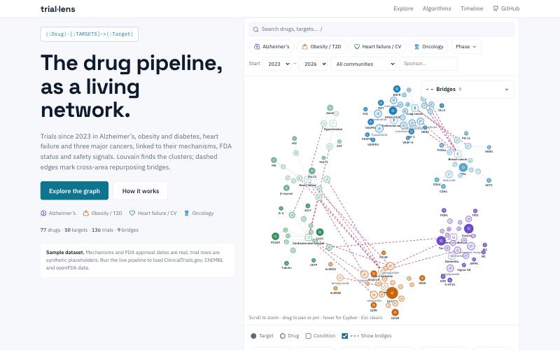
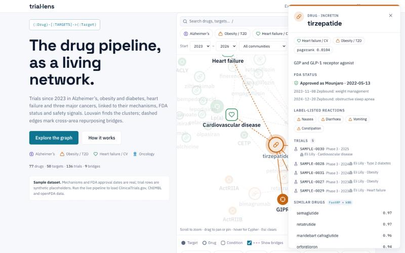
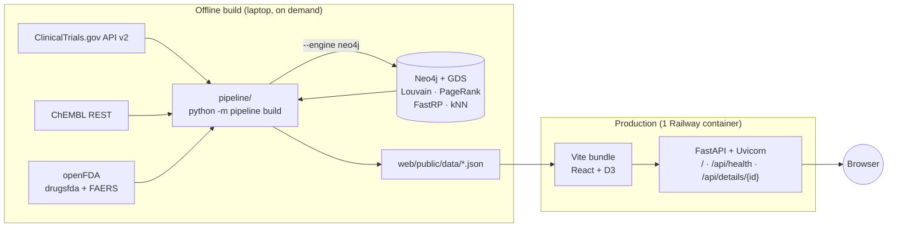

# Clinical Trial Lens · Mechanism Network

An interactive **drug → target → condition** network of clinical trials started 2023–2026 in four areas: Alzheimer's, obesity/T2D, heart failure/CV, and lung/breast/colorectal cancer. Nodes are colored by **Louvain community**, sized by **PageRank**, and linked to look-alike drugs through **FastRP + kNN** embeddings. Cross-area **repurposing bridges** are drawn as dashed edges. Hover any element to see the exact **Cypher** behind it.

Graph analytics run **offline** in Neo4j Graph Data Science, and production serves only static JSON. The whole app is one small container with no database, which fits a ~$5/month budget.




> **Not medical advice.** The committed dataset is a **sample**: drug mechanisms and FDA approval dates are public facts, but trial rows are **synthetic** (`SAMPLE-xxxx`). The app labels them that way. Run the live pipeline to load real registry data.

---

## Architecture



- **Neo4j is a build tool, not a production dependency.** The pipeline loads the graph, runs GDS, reads the results back and writes JSON. No credentials ever reach production.
- **The `/api/details/{id}` route is a thin file read for now.** Its body can later be swapped for a live Neo4j query without touching the frontend.
- **Engines are swappable.** `--engine local` runs the same three algorithms in networkx/numpy, so a fresh clone (or CI) can rebuild everything with $0 of infrastructure.

## Repository layout

```
pipeline/                 offline Python CLI  (python -m pipeline build)
  extract.py              1  ClinicalTrials.gov v2 → trials (2023+, drug/biologic)
  enrich.py               2-3 ChEMBL mechanisms/targets · openFDA approvals + FAERS
  dataset.py              live or sample source → one normalized shape
  graph.py                drug–target–condition graph (Drug→Condition from trials)
  cypher.py               every Cypher/GDS statement, the single source of truth
  analyze_neo4j.py        4-5 load (UNWIND+MERGE) → GDS → read back
  analyze_local.py        4-5 networkx/numpy mirror of the GDS algorithms + layout
  export.py               6-7 bridges, 500-node cap, JSON + schema validation
  schema.json             JSON Schema for graph.json
  seed/sample.json        curated offline dataset (77 drugs, 50 targets)
server/main.py            FastAPI: static bundle + /api/health + /api/details/{id}
web/                      React 18 + Vite + TypeScript + D3 v7 + Zustand + Fuse.js
  public/data/            built JSON (committed; production serves it as-is)
  src/components/         NetworkCanvas, FilterBar, SearchBox, NodeDrawer,
                          BridgesPanel, Legend, CypherLens, AlgorithmCards, Timeline
  src/lib/                data loading, store (URL-synced), graph helpers, lens
  src/styles/tokens.css   every color/space/radius token (light theme)
tests/                    pytest smoke tests (contract, algorithms, API safety)
Dockerfile · railway.json one service, multi-stage build
```

## Quick start (sample data, no network, $0)

Needs Python 3.11+ and Node 20+.

```bash
pip install -r requirements.txt -r pipeline/requirements.txt
```

```bash
python -m pipeline build
```

```bash
cd web && npm ci && npm run build && cd ..
```

```bash
uvicorn server.main:app --port 8000
```

Open http://localhost:8000.

**Frontend dev loop:** run `npm run dev` in `web/` for hot reload on :5173. It proxies `/api` to :8000 when uvicorn is running, and falls back to the static detail files when it isn't.

**Tests:**

```bash
python -m pytest -q
```

## Live data build

```bash
python -m pipeline build --source live
```

This pulls ClinicalTrials.gov, ChEMBL and openFDA. Every response is cached in `cache/`, so reruns make zero API calls and stay well under openFDA's 240 requests/minute anonymous limit. Use `--max-pages 2` for a quick, smaller run.

**With Neo4j + Graph Data Science** (the reference engine). Start Neo4j locally with the GDS plugin:

```bash
docker run -d --name neo4j -p 7474:7474 -p 7687:7687 -e NEO4J_AUTH=neo4j/localpassword -e NEO4J_PLUGINS='["graph-data-science"]' neo4j:5
```

```bash
pip install neo4j && NEO4J_PASSWORD=localpassword python -m pipeline build --source live --engine neo4j
```

`NEO4J_URI` (default `bolt://localhost:7687`) and `NEO4J_USER` (default `neo4j`) are also read. Commit the regenerated `web/public/data/`, then push to redeploy. Rebuild about monthly.

## Deploy (Railway)

1. Push the repo to GitHub, then create a Railway service from it. `railway.json` selects the Dockerfile and the `/api/health` health check.
2. Optional: the header links to this repo by default; set the service variable `VITE_GITHUB_URL` to point it at a fork.
3. Every push to `main` redeploys. A custom domain is optional.

The image is `python:3.12-slim` plus FastAPI, Uvicorn and the static bundle, with no database and no secrets.

## Budget

| Item | Cost |
| --- | --- |
| Railway Hobby (one always-on, small container) | ~$5/mo, within included usage |
| Neo4j | $0: local Docker/Desktop or AuraDB Free, build time only |
| ClinicalTrials.gov, ChEMBL, openFDA | $0: public APIs, cached on disk |
| Fonts (Google), icons (Lucide, ISC) | $0, no attribution required |

Performance budgets from the spec, as measured on the sample build:

| Budget | Spec | Sample build |
| --- | --- | --- |
| Initial JS, gzipped (Fuse.js lazy-loaded separately) | < 180 KB | 91 KB |
| `graph.json`, gzipped | < 250 KB | 7 KB |
| Each details file | < 15 KB | 0.5–6 KB |

Static assets are served `immutable` for a year, and JSON with `max-age=86400`.

## How the page works

- **Network:** an SVG with D3 force for ≤ 500 nodes. Layout is precomputed offline (communities on a ring, each spring-laid-out inside its own disc), then a short live simulation settles it (`alphaDecay 0.05`). With reduced motion there is no simulation.
- **Interactions:**
  - Hover dims non-neighbours to 15%; click selects, opens the drawer and updates the URL.
  - Scroll or pinch zooms 0.3–4×; drag pans, or drags a node to pin it (double-click unpins).
  - `/` focuses search, `Esc` clears the selection, `C` pins the Cypher lens.
- **Filters:** area chips, phase, start-year range, community and sponsor. Filtered-out nodes fade to 10% rather than vanishing, and every view is a shareable URL (`?node=…&areas=…&phases=…`).
- **Search:** Fuse.js over `search-index.json`, which covers every drug, including those beyond the 500-node cap. Those drugs load their neighbours on demand.
- **Cypher lens:** templates come from `cypher.json`, which is exported from `pipeline/cypher.py`, the same strings the Neo4j engine executes. When a build used the local engine, the lens says so.
- **Algorithm cards:** these read live from `graph.json`.
  - PageRank toggles node sizing.
  - Louvain toggles community colouring and filters by a community.
  - FastRP + kNN lists the selected drug's neighbours and highlights them in the graph.
- **Accessibility:** the SVG has `role="img"` with a summary, plus a keyboard-reachable "View as table". Controls are real buttons with a 2 px focus ring, shapes carry the node type, and the drawer becomes a bottom sheet on phones.

## JSON contract

`graph.json` (≤ 500 nodes: all targets and conditions, then drugs by PageRank):

```json
{
  "nodes": [{"id": "drug:tirzepatide", "type": "drug", "label": "tirzepatide", "community": 2,
             "pagerank": 0.0104, "area": "obes", "areas": ["hf", "obes"], "maxPhase": "approved",
             "sponsors": ["Eli Lilly"], "firstStart": 2023, "years": [2023, 2024, 2025],
             "bridge": true, "x": -120.4, "y": 310.2}],
  "links": [{"source": "drug:tirzepatide", "target": "tgt:GLP1R", "type": "TARGETS", "bridge": false}],
  "communities": [{"id": 2, "label": "Incretin", "size": 23, "area": "obes", "tint": 0}]
}
```

The pipeline also writes these files:

- `details/<id>.json`: the drawer data (trials, FDA status, FAERS terms, similar drugs, neighbours).
- `search-index.json`: every node, for search.
- `cypher.json`: the lens templates.
- `timeline.json`: the timeline lanes.
- `meta.json`: build date, source and engine.

## Notes and deviations from the spec

- **Source:** the spec names the AACT flat-file snapshot. The pipeline reads the same registry through the ClinicalTrials.gov v2 API instead, which avoids a ~2 GB download on a laptop.
- **Icons:** Lucide (the spec's fallback) instead of Flaticon. It is open-licensed, tree-shaken, and needs no attribution.
- **Timeline:** the pipeline emits `timeline.json`, and the page renders it as a static, non-interactive SVG. That keeps it on theme tokens.
- **Bridges:** a bridge is a drug with trials in ≥ 2 areas (listed in the panel), or an edge joining two Louvain communities (drawn dashed). This follows the spec exactly.
- **Sample-data caveats:**
  - Adverse-event chips show label-listed reactions without counts.
  - Live builds show raw FAERS counts (not PRR).
- **Open questions carried over from the spec:**
  - ChEMBL match rate for 2023+ investigational codes. A starter alias table is in `pipeline/seed/aliases.csv`.
  - Whether to replace raw FAERS counts with PRR.
